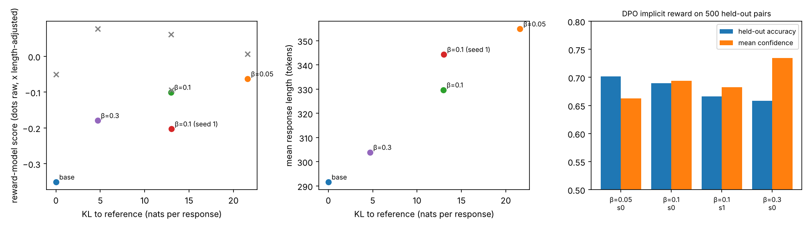

# DPO Reliability Audit and Safety-Judge Calibration Under Jailbreak Shift

Two small, fully measured studies run on one NVIDIA V100 (16 GB) on the ODU Wahab cluster.
Every number below comes from `results/summary.json` and `results/safety_key_results.md`.

## Study 1. What does DPO actually buy, and at what cost?

**Setup.** Qwen2.5-0.5B-Instruct, LoRA rank 16 on all attention and MLP projections (8.8M trainable parameters),
self-contained DPO implementation in PyTorch (reference = same weights with the adapter disabled),
5,000 UltraFeedback-binarized training pairs, one epoch, effective batch 8, learning rate 5e-5,
beta in {0.05, 0.1, 0.3}, plus a second seed at beta 0.1. Evaluation on prompts disjoint from training:
500 held-out preference pairs, and 200 held-out prompts sampled at temperature 1 (up to 512 tokens),
scored by an independent reward model (OpenAssistant DeBERTa-v3-large) with identical sampling noise across models.

| Run | Held-out implicit-reward accuracy (95% CI) | Implicit-reward ECE | Mean confidence | KL to reference (nats) | Mean length (tokens) | Reward-model score raw / length-adjusted | Win rate vs base |
|---|---|---|---|---|---|---|---|
| Base | n/a | n/a | n/a | 0.0 | 291.6 | -0.351 / -0.050 | n/a |
| beta 0.05 | 0.702 (0.660 to 0.742) | 0.042 | 0.663 | 21.6 | 354.9 | -0.063 / 0.007 | 0.545 |
| beta 0.1 | 0.690 (0.648 to 0.734) | 0.061 | 0.694 | 13.0 | 329.7 | -0.100 / 0.061 | 0.525 |
| beta 0.1, seed 1 | 0.666 (0.622 to 0.710) | 0.031 | 0.682 | 13.0 | 344.3 | -0.203 / -0.095 | 0.550 |
| beta 0.3 | 0.658 (0.616 to 0.700) | 0.074 | 0.734 | 4.7 | 303.9 | -0.179 / 0.077 | 0.495 |



**Findings.**
1. DPO learned the preference signal: held-out implicit-reward accuracy of 0.66 to 0.70, against 0.546 for the base model's length-normalized log-probability.
2. Lower beta moved the policy further from the reference (KL 4.7 to 21.6 nats) and made responses longer (304 to 355 tokens versus 292 for the base).
3. The reward model prefers longer answers (correlation 0.38 between score and length; about +0.37 score per 100 tokens). After a pooled length adjustment, the low-beta run's apparent lead disappears: beta 0.05 has the best raw score but the highest-beta run has the best length-adjusted score. Paired win rates against the base stay between 0.495 and 0.55, close to a coin flip.
4. As beta grows (seed 0), the implicit reward becomes more confident but less accurate: mean confidence rises from 0.66 to 0.73 while accuracy falls from 0.70 to 0.66, moving from slight underconfidence at beta 0.05 to overconfidence at beta 0.3 (ECE 0.042 to 0.074). The second beta 0.1 seed had ECE 0.031, so this trend needs more seeds.
5. Seed variance is as large as the beta effect on generation quality: the two beta 0.1 seeds differ by 0.10 in raw reward score and by 0.024 in held-out accuracy at the same KL.

**Limitations.** One model size, one epoch, one reward model as judge, two seeds for a single beta, responses truncated at 256 tokens in training and 512 at generation (25% to 37% of samples hit the cap). No human evaluation.

## Study 2. Do safety-judge calibration and thresholds survive jailbreak prompts?

**Setup.** ToxicChat (toxicchat0124): 5,082 training and 5,083 test user prompts; the test set has 362 toxic and 91 jailbreak prompts (all 91 labeled toxic).
Judges: TF-IDF logistic regression, and prompted Qwen2.5-0.5B and 1.5B Instruct scored by P(Yes) against P(No).
Platt and isotonic calibrators and a 5% false-positive threshold were fit on 2,000 held-out training prompts only, then frozen.

| Judge | Test AUROC | ECE overall (Platt) | ECE on jailbreaks (raw / Platt) | Realized FPR | Miss rate, ordinary toxic | Miss rate, jailbreaks |
|---|---|---|---|---|---|---|
| TF-IDF + logistic regression | 0.909 | 0.010 | 0.222 / 0.325 | 0.052 | 0.325 | 0.088 |
| Qwen2.5-1.5B-Instruct | 0.826 | 0.012 | 0.638 / 0.710 | 0.050 | 0.664 | 0.473 |
| Qwen2.5-0.5B-Instruct | 0.453 (raw) | 0.012 | 0.323 / 0.925 | 0.051 | 0.753 | 0.978 |

**Findings.**
1. Aggregate calibration hides the failure: after Platt scaling, overall ECE is about 0.01, yet 0.33 and 0.71 on jailbreak prompts, which are under 2% of the test set.
2. Calibration fit on ordinary traffic made jailbreak calibration worse for every judge.
3. The 5%-FPR threshold transferred on false positives but the prompted 1.5B judge still missed 47% of jailbreaks.
4. A lexical baseline outranked the prompted 1.5B judge; the 0.5B judge was below chance before calibration.

## Reproduce

```
python prep.py                                  # cache model, reward model and data (login node)
sbatch --export=ALL,EXTRA="--gen_tokens 512" run_dpo.sbatch             # base + beta 0.05 / 0.1 / 0.3
sbatch --array=2 --export=ALL,SEED=1,EXTRA="--gen_tokens 512" run_dpo.sbatch
sbatch run_safety.sbatch
python aggregate.py
```
Software: torch 2.4.1+cu121, transformers 4.51.3, peft 0.15.2, scikit-learn 1.4.1.post1. Each DPO run took about 32 minutes on a V100.

Author: Shadman Mahmood Khan Pathan, Old Dominion University.
